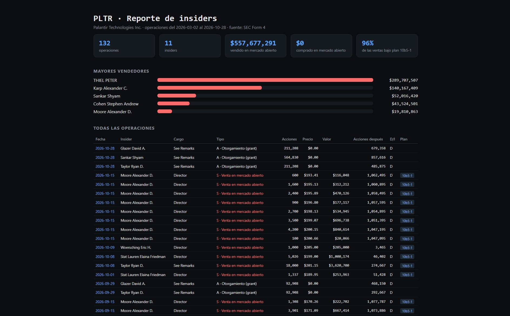

# SEC Insider Crawler

Crawler en Python que descarga los **Form 4** de la SEC (los reportes donde directivos,
consejeros y grandes accionistas declaran sus compras y ventas de acciones), extrae cada
operación y genera un **CSV** y un **reporte HTML**.



## ¿Qué responde?

- ¿Quién está comprando o vendiendo acciones de la empresa, y por cuánto?
- ¿Las ventas fueron programadas (plan 10b5-1) o decisiones discrecionales?
- ¿Hay **compras en mercado abierto**? (la señal que más siguen los analistas)

Ejemplo con Palantir (PLTR), últimos 40 Form 4: **$558 M vendidos**, 96 % bajo planes
10b5-1 y **ninguna compra** en mercado abierto.

## Instalación

```bash
git clone https://github.com/VRVC/sec-insider-crawler.git
cd sec-insider-crawler
python -m venv venv
venv\Scripts\activate          # Windows  (Mac/Linux: source venv/bin/activate)
pip install -r requirements.txt
```

La SEC exige identificarse con un correo. Copia `.env.example` como `.env` y escribe el tuyo:

```text
SEC_EMAIL=tu-correo@ejemplo.com
```

## Uso

```bash
python main.py PLTR                     # últimos 40 Form 4
python main.py NVDA --max-filings 20    # otra empresa, menos reportes
```

Genera `output/insiders_<TICKER>.csv` y `output/reporte_<TICKER>.html`, y abre el
reporte en el navegador.

## Cómo funciona

```text
ticker ──► CIK ──► lista de Form 4 ──► XML de cada reporte ──► operaciones ──► CSV + HTML
          (SEC)     (JSON de EDGAR)       (descarga)            (parser)       (pandas)
```

| Archivo | Responsabilidad |
|---|---|
| `sec_api.py` | Comunicación con la SEC: ticker → CIK, lista de Form 4, descargas con límite de velocidad |
| `parser_form4.py` | Convierte el XML de un Form 4 en una lista de operaciones |
| `reporte.py` | Genera el reporte HTML (KPIs, mayores vendedores, tabla) |
| `main.py` | Punto de entrada: orquesta todo y guarda los resultados |

## Cómo leer los datos

| Código | Significado |
|---|---|
| **P** | Compra en mercado abierto (con su propio dinero) |
| **S** | Venta en mercado abierto |
| **A** | Otorgamiento de acciones como compensación (precio $0) |
| **M** | Ejercicio de opciones o RSU |
| **F** | Acciones retenidas para pagar impuestos |
| **G** | Regalo o transferencia |

- **Plan 10b5-1:** ventas programadas con meses de anticipación; dicen poco sobre lo que
  el insider piensa hoy.
- **D / I:** propiedad directa o indirecta (fideicomisos, fondos, familiares). Las
  acciones restantes se reportan por separado para cada tipo.

## Limitaciones

- Solo procesa operaciones con acciones comunes (`nonDerivativeTable`); no incluye opciones ni RSU.
- No procesa enmiendas (Form 4/A).
- Usa los ~1,000 reportes más recientes que la SEC entrega en su API de *submissions*.

## Próximos pasos

- [ ] Alertas cuando un insider **compre** en mercado abierto
- [ ] Leer el cargo real cuando dice "See Remarks"
- [ ] Incluir derivados (opciones y RSU)
- [ ] Comparar la actividad de insiders contra el precio de la acción

## Fuente de datos

[SEC EDGAR](https://www.sec.gov/edgar), datos públicos. Respeta el límite de 10
peticiones por segundo de la SEC.